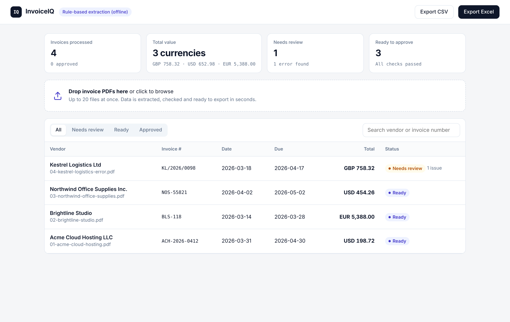
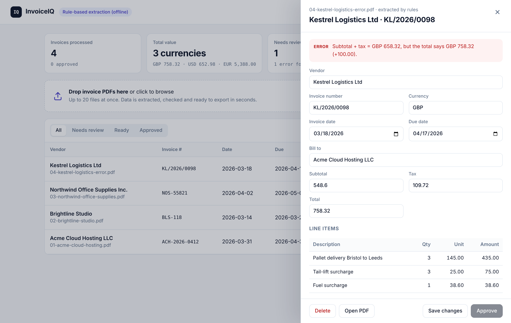

# InvoiceIQ

**Turn invoice PDFs into clean, checked data, and catch billing errors before you pay.**

Upload invoices and InvoiceIQ pulls out:
- the vendor, invoice number, dates, customer and currency;
- the subtotal, tax, total and every line item.

It then checks that the numbers actually add up, flags anything that needs a human, and exports everything to Excel or CSV.





*The sample Kestrel Logistics invoice claims a balance of £758.32, but its subtotal plus VAT is £658.32. InvoiceIQ flags the +£100.00 difference and blocks approval until someone fixes it.*

## Features

- **Two extraction engines**
  - **Claude:** uses forced tool use, so the output is always schema-valid JSON.
  - **Rule-based:** works fully offline with no API key, and handles common label styles, date formats and currencies.
  - **Fallback:** if a Claude call fails, the upload falls back to the rule-based engine instead of failing.
- **Validation that catches real problems**
  - Line items don't add up to the subtotal.
  - Subtotal + tax ≠ total (with the exact difference).
  - Quantity × unit price ≠ line amount.
  - Missing invoice number, date or total.
  - Due date before the invoice date, or an invoice dated in the future.
  - Duplicate invoices (same vendor and invoice number).
- **Review workflow**
  - Statuses: `needs_review` → `ready` → `approved`.
  - Edits are re-validated instantly, and approval is blocked while errors remain.
- **Exports**
  - Excel, with an Invoices sheet and a Line items sheet, formatted and with frozen headers.
  - CSV.
- **Dashboard:** drag-and-drop batch upload (up to 20 PDFs), status filters, search, and a side-by-side review drawer.
- **REST API:** documented automatically at `/docs` (OpenAPI / Swagger).

## Tech stack

| Layer | Tools |
|---|---|
| API | FastAPI, Pydantic v2, SQLModel (SQLAlchemy), SQLite (any SQLAlchemy URL works) |
| Extraction | pdfplumber, Anthropic Claude (tool use), regex-based rules engine |
| Export | openpyxl, csv |
| Front end | Jinja2 + vanilla JS (no build step) |
| Quality | pytest (33 tests), Ruff, GitHub Actions on Python 3.11–3.13, Docker |

## How it works

```
PDF upload ─► pdfplumber text layer ─► extractor ─► validator ─► SQLite ─► dashboard / API / Excel
                                       │
                                       ├─ Claude (tool use, JSON schema)   when ANTHROPIC_API_KEY is set
                                       └─ Rules engine (offline)           otherwise, or if Claude fails
```

The rules engine reads:
- **Labels** such as "Invoice No", "Date of issue", "Payment due", "Subtotal", "VAT 20%" and "Balance Due".
- **Line-item rows** shaped like `description  qty  unit price  amount`. Descriptions can contain numbers, for example `Cloud VPS - 4 vCPU / 8 GB`.
- **Dates** in these formats: `2026-03-31`, `31/03/2026`, `03/31/2026`, `14 March 2026`, `March 14, 2026` and `14th Sept 2026`.

When it isn't sure about a field it leaves it empty, and the validator reports what's missing. Nothing is invented.

## Quick start

```bash
git clone https://github.com/ahmad0187/invoiceiq-Python.git
cd invoiceiq-Python
python -m venv .venv && source .venv/bin/activate
pip install -r requirements-dev.txt
uvicorn app.main:app --reload
```

Open http://localhost:8000 and drop in the PDFs from `samples/`. The API docs are at http://localhost:8000/docs.

**Use Claude for extraction (optional):**
```bash
cp .env.example .env      # then set ANTHROPIC_API_KEY
```

**Docker:**
```bash
docker build -t invoiceiq .
docker run -p 8000:8000 -e ANTHROPIC_API_KEY=your-key invoiceiq
```

**Tests:**
```bash
pytest -q
ruff check app tests samples
```

## API

| Method | Endpoint | Description |
|---|---|---|
| `POST` | `/api/invoices` | Upload one or more PDFs (`files` field, multipart) |
| `GET` | `/api/invoices?status=&q=` | List, filter by status, search by vendor or number |
| `GET` | `/api/invoices/{id}` | One invoice with line items and issues |
| `PATCH` | `/api/invoices/{id}` | Correct fields; the invoice is re-validated |
| `POST` | `/api/invoices/{id}/approve` | Approve (refused with `409` while errors remain) |
| `DELETE` | `/api/invoices/{id}` | Delete the invoice and its PDF |
| `GET` | `/api/export?format=xlsx\|csv&status=` | Download an export |
| `GET` | `/api/health` | Shows which extractor is active |

## Project structure

```
app/
  main.py            FastAPI routes
  models.py          SQLModel tables (Invoice, LineItem)
  schemas.py         Pydantic shapes shared by extractors, validator and API
  validate.py        Business rules that catch errors
  export.py          Excel / CSV export
  extract/
    pdf_text.py      PDF text layer
    rules.py         Offline rule-based extractor
    llm.py           Claude extractor (tool use)
    pipeline.py      Picks the extractor, falls back safely
  templates/, static/  Dashboard
samples/             Fictional sample invoices + the script that generates them
tests/               Unit and API tests
```

## Limitations

- Scanned (image-only) PDFs need OCR first; InvoiceIQ rejects them with a clear message.
- The rules engine targets common layouts. Unusual layouts work best with the Claude extractor.
- Authentication isn't included. Put it behind your own login or a reverse proxy before exposing it publicly.

## License

MIT. Built by [Ahmad Murtaza](https://github.com/ahmad0187).
